# Brilliant Web Skill

An agent skill (and a plain CSS/JS kit) that reproduces the **brilliant.org design language** for web apps, landing pages, lesson players, dashboards, PDF documents, slide decks and interactive visuals.

Every colour, text style, radius, spacing step, shadow, breakpoint, z-index and keyframe was **extracted from brilliant.org's production CSS** (Panda CSS, captured 27 October 2026) and turned into tokens; component geometry was measured from the live markup with Playwright. The logged-in lesson experience, which isn't public, is reconstructed from those tokens and refined with patterns from [AI Engineering Blueprint](https://sawabs.github.io/ai-engineering-blueprint/).

<picture>
  <source media="(prefers-color-scheme: dark)" srcset="preview/svg/poster-dark.svg">
  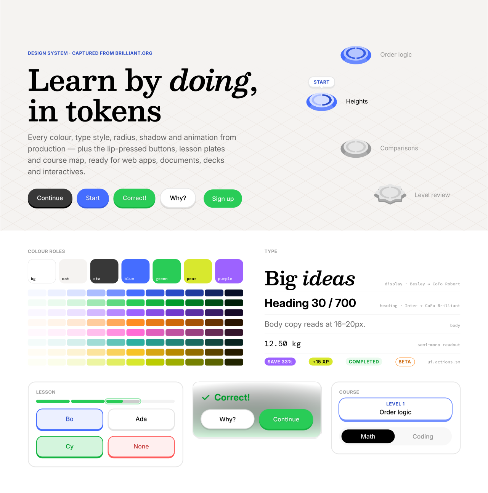
</picture>

<sub>Every image in this README is a vector SVG exported from the live templates (`tools/export_vector.py`) — sharp at any zoom, and it follows your GitHub light/dark theme.</sub>

## What's inside

```
SKILL.md                 ← entry point for Claude / agents: rules, file map, checklist
tokens/                  ← tokens.css (light + dark), fonts.css + fonts/ (bundled OFL faces), tokens.json (DTCG), tailwind.preset.js
css/                     ← brilliant.css (components) · print.css (A4 documents) · deck.css (16:9 slides)
js/brilliant.js          ← theme toggle, segmented/chips/tabs/choices, slider fill, beat reveal, synthesized sounds
assets/icons.svg         ← original 24px icon sprite
templates/               ← landing · app-course · app-lesson · dashboard · interactive · deck · document · social-card
tools/md2pdf/            ← Markdown → Brilliant-style PDF (cover, contents, parts, coins, callouts, Mermaid, KaTeX)
tools/                   ← export_vector.py (HTML → SVG), lattice.py, build_tokens.py, build_token_docs.py, capture/, screenshot.py, inline_icons.py
references/              ← 01 foundations … 10 token tables
source/                  ← the raw captured token values
preview/                 ← index.html specimen · poster.html · svg/ (vector exports used below)
```

## Use it as a skill

Claude Code / Agent SDK:

```bash
git clone https://github.com/SawabS/brilliant-web-skill ~/.claude/skills/brilliant-design
```

Then ask for "a Brilliant-style …" (landing page, lesson, dashboard, report PDF, deck, explorable). The agent reads `SKILL.md`, picks a template and the matching reference, and builds with the tokens.

## Use it directly

```html
<link rel="stylesheet" href="tokens/fonts.css">
<link rel="stylesheet" href="tokens/tokens.css">
<link rel="stylesheet" href="css/brilliant.css">
<script src="js/brilliant.js" defer></script>

<h1 class="ts-display-6xl">Learn by doing</h1>
<button class="btn3d btn3d--blue"><span class="btn3d__face">Start</span></button>
```

Tailwind: `presets: [require('./tokens/tailwind.preset.js')]` (keep `tokens.css` loaded; colours resolve through CSS variables so `data-theme="dark"` just works).

PDF from Markdown:

```bash
pip install markdown-it-py playwright && playwright install chromium
python3 tools/md2pdf/md2pdf.py report.md          # → report.pdf
```

## Screens

**Landing** — oat hero on the isometric lattice, display serif, 3D buttons.

<picture>
  <source media="(prefers-color-scheme: dark)" srcset="preview/svg/landing-dark.svg">
  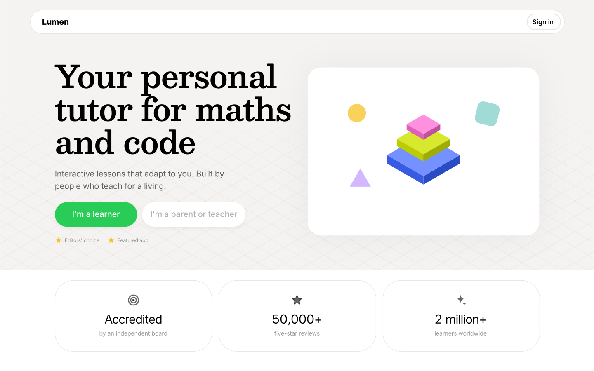
</picture>

**Course map** — the lesson path: 3D plate nodes with split progress rings, a review star, the centre / start / centre / end rhythm, level headers and the Start bubble.

<picture>
  <source media="(prefers-color-scheme: dark)" srcset="preview/svg/course-dark.svg">
  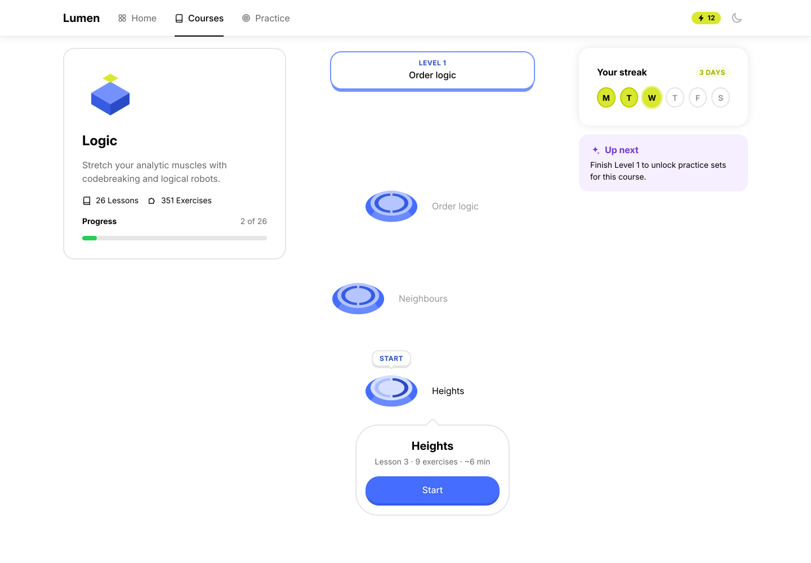
</picture>

| Lesson (mobile, feedback sheet) | Lesson (explore step) |
|---|---|
| 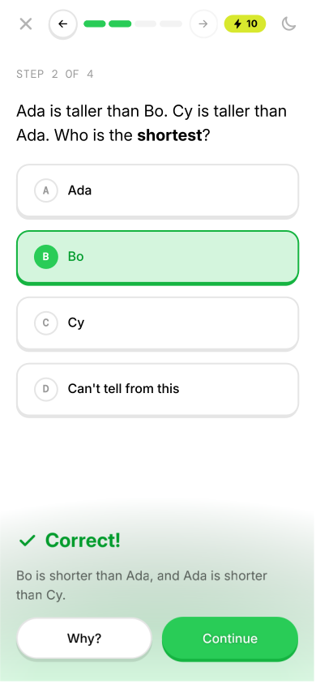 | 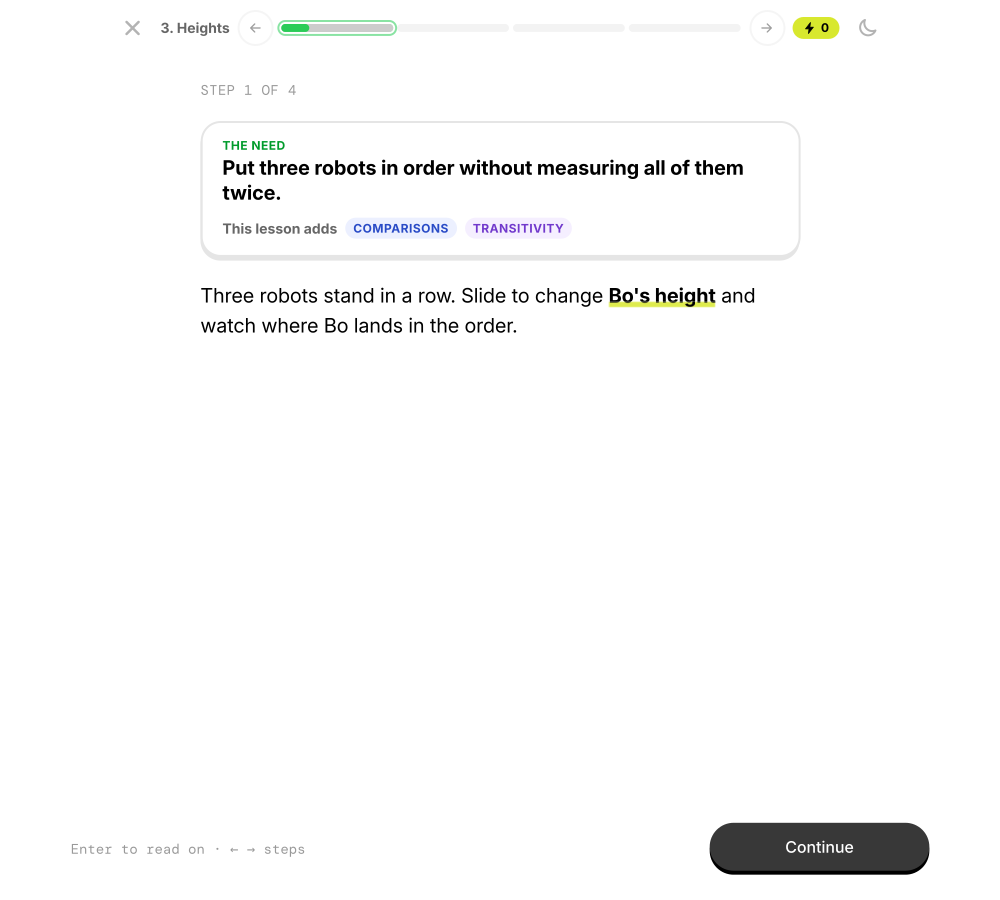 |

| Dashboard (dark) | Interactive explorable |
|---|---|
| 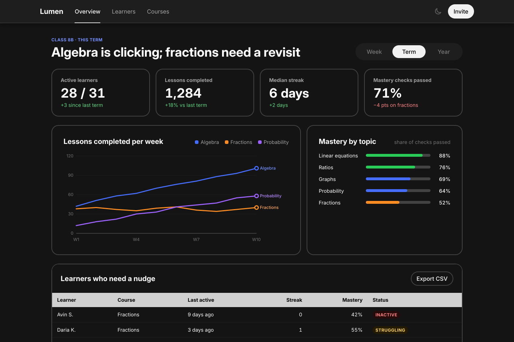 | 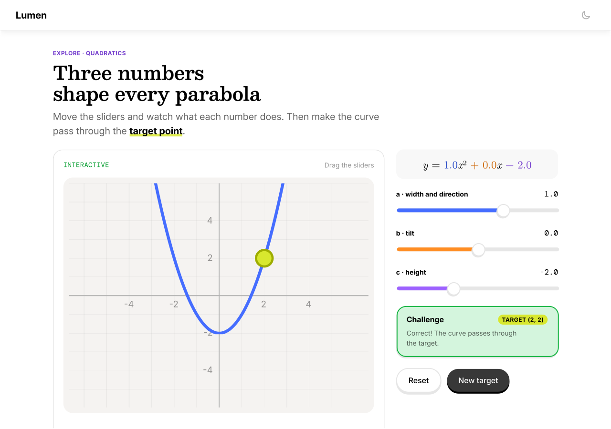 |

| Deck — title | Deck — stats |
|---|---|
| 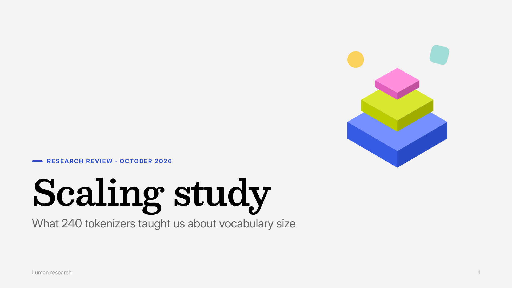 | 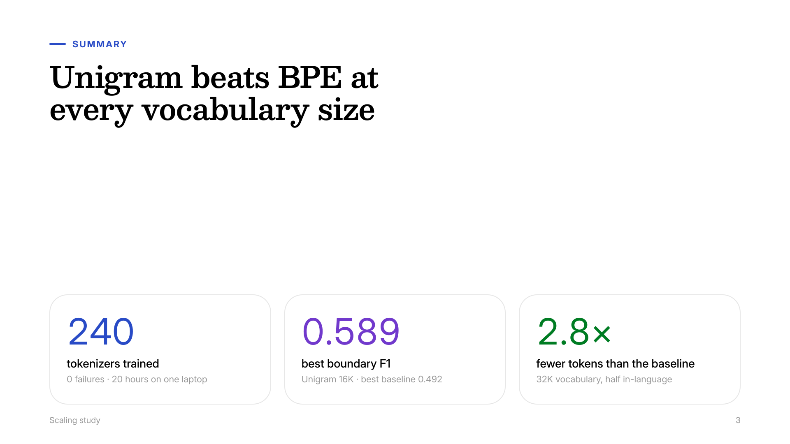 |

| Document (md2pdf) — cover | Document — inner page | Social card (1200×630) |
|---|---|---|
| 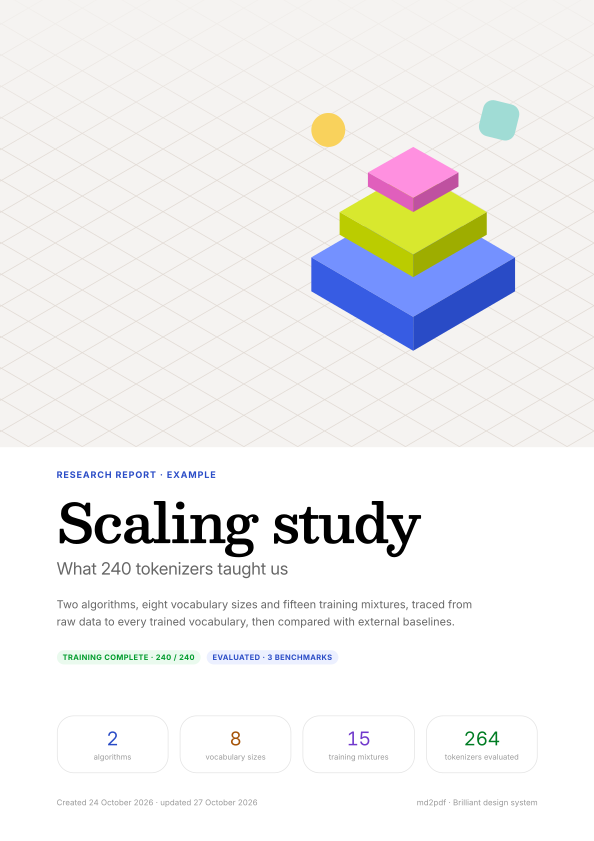 | 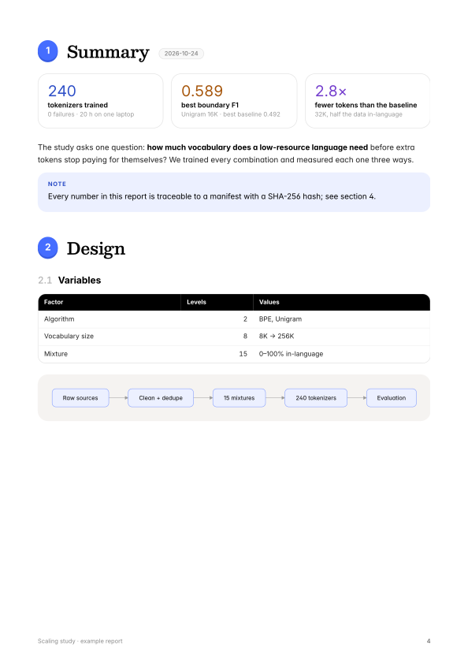 | 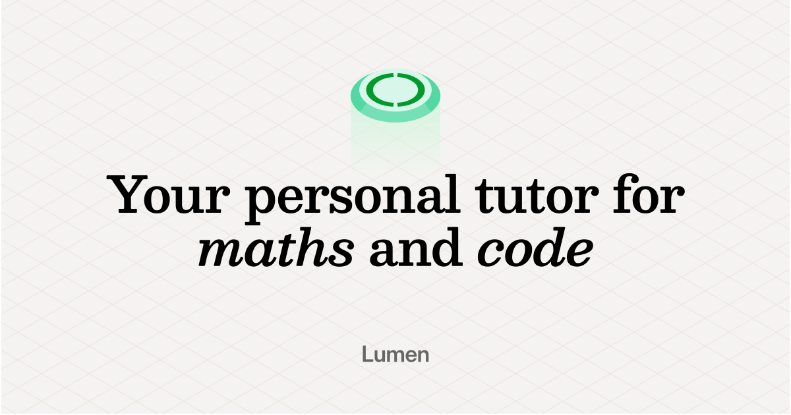 |

Re-export any of them (or your own page) as vector:

```bash
python3 tools/export_vector.py templates/landing.html landing.svg --width 1440 --height 900 --theme dark
python3 tools/export_vector.py preview/index.html buttons.svg --selector "#buttons"
```

## Fonts and brand

Brilliant's typefaces (CoFo Brilliant, CoFo Robert, CoFo Semi Mono by Contrast Foundry) are commercial and **not included**; the stacks put them first, so they're used if you license and install them. Open substitutes are **bundled** in `tokens/fonts/` (SIL OFL), so pages and PDFs render the same offline:

| Brilliant | Bundled substitute | Why |
|---|---|---|
| CoFo Robert 500 (display) | **Besley** at wght 600, registered as "Besley Display" 500 | CoFo Robert is a contemporary Clarendon named after Robert Besley; Besley revives his original Clarendon. Picked by rendering candidates against Brilliant's own headline art. |
| CoFo Brilliant (UI / body) | Inter | Metrics within ~2%. |
| CoFo Semi Mono (readouts) | DM Mono | |
| Source Code Pro, KaTeX | the same | exact |

Campaign headlines set their key words in the display italic — `Your personal tutor for <em>maths</em> and <em>code</em>` — which `.ts-display-*` classes do automatically.

This repository reproduces a visual language, not a brand: it contains no Brilliant logo, wordmark, characters, illustrations or animations, and the templates use a placeholder product name ("Lumen"). Don't use it to build anything that could be mistaken for brilliant.org.

## Refreshing the tokens

```bash
# capture main.css from brilliant.org (any scraper/browser), then:
python3 tools/capture/extract_tokens.py main.css source/brilliant-tokens.json
python3 tools/build_tokens.py && python3 tools/build_token_docs.py
python3 tools/inline_icons.py templates/*.html preview/index.html
```

