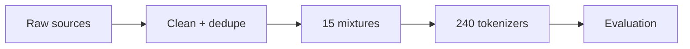
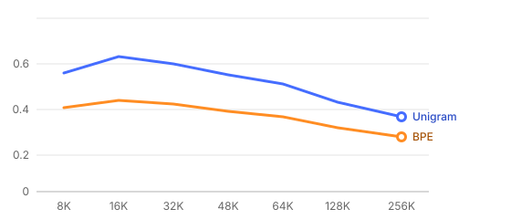

# Part I · The study
*What was asked, and how the experiment is built.*

## 1. Summary (2026-10-24)

```stats
240 | tokenizers trained | 0 failures · 20 h on one laptop
0.589 | best boundary F1 | Unigram 16K · best baseline 0.492
2.8× | fewer tokens than the baseline | 32K, half the data in-language
```

The study asks one question: **how much vocabulary does a low-resource language need** before extra tokens stop paying for themselves? We trained every combination and measured each one three ways.

> **Note.** Every number in this report is traceable to a manifest with a SHA-256 hash; see section 4.

## 2. Design

### 2.1 Variables

| Factor | Levels | Values |
|---|---|---|
| Algorithm | 2 | BPE, Unigram |
| Vocabulary size | 8 | 8K → 256K |
| Mixture | 15 | 0–100% in-language |



# Part II · Results
*How the 240 tokenizers perform against 24 baselines.*

## 3. Unigram beats BPE at every size



*Figure 1. Morpheme-boundary F1 by vocabulary size. Unigram (blue) leads BPE (orange) at every size; both fall after 32K.*

The objective Unigram maximises is the likelihood of the corpus under a unigram model:

$$\mathcal{L} = \sum_{s \in D} \log \sum_{x \in S(s)} \prod_{i} p(x_i)$$

> **Caveat.** Medians hide the spread: at 256K the worst mixture scores 0.31 lower than the best.

> **Done.** All 240 models restored from their manifests with 480 / 480 hashes matching.

## 4. Reproduce it

```python
def train(mix, algo, size):
    # one SentencePiece run per cell of the grid
    return spm.train(input=mix, model_type=algo, vocab_size=size * 1024)  # "deterministic"
```
